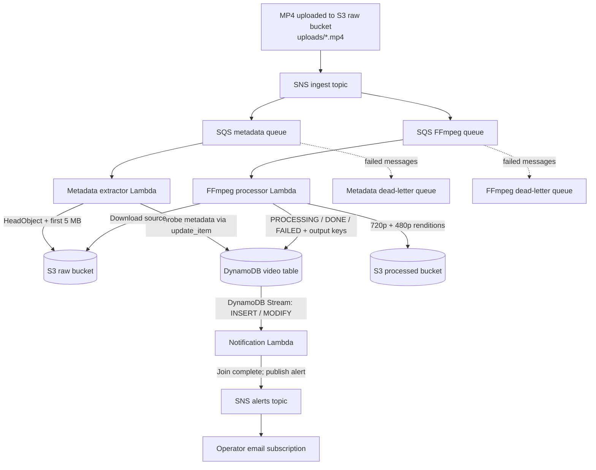

# AWS Video Processing Pipeline

An event-driven AWS pipeline that accepts MP4 uploads, extracts video metadata, creates 720p and 480p renditions, records processing state, and notifies an operator when processing finishes.

This repository contains Python 3.12 Lambda handlers and Terraform infrastructure. The FFmpeg/FFprobe Lambda Layer ZIPs are required deployment inputs; ZIP files are excluded by `.gitignore`, so make sure those artifacts are available locally before applying Terraform. This README describes the code and infrastructure currently in the repository and does not imply a particular production deployment.

## Architecture



### End-to-end flow

1. An object-created event for an `.mp4` under the `uploads/` prefix is sent from the raw S3 bucket to the SNS ingest topic.
2. SNS fans out the event to separate SQS queues so metadata extraction and transcoding can run independently.
3. The metadata Lambda reads object headers and downloads the first 5 MB with `boto3`. It runs FFprobe and writes the file size, content type, resolution, duration, codec, and extraction timestamp to DynamoDB.
4. The FFmpeg Lambda downloads the full source video to `/tmp`, runs FFmpeg, and uploads H.264/AAC MP4 renditions at 720p and 480p to the processed S3 bucket. It records its status and output keys in DynamoDB.
5. DynamoDB Streams invokes the notification Lambda. It checks that transcoding is `DONE` and that metadata extraction has written `metadata_extracted_at`. When both conditions are present, it publishes a message to the alerts SNS topic.
6. An operator can subscribe an email address to the alerts topic. Email subscriptions must be confirmed with SNS.

## Components

| Component | Responsibility | Implementation |
|---|---|---|
| Raw S3 bucket | Receives source videos under `uploads/` | Private access, server-side encryption, versioning, and configurable lifecycle expiration |
| Ingest SNS topic | Fans out each qualifying S3 event | Subscriptions deliver raw event payloads to both SQS queues |
| SQS queues and DLQs | Buffer work independently and retain repeatedly failing messages | Separate queues for metadata and transcoding; configurable retry counts and 14-day DLQs by default |
| Metadata extractor | Reads basic S3 metadata and probes video properties | Python, `boto3`, FFprobe Lambda Layer, DynamoDB `update_item` |
| FFmpeg processor | Creates 720p and 480p renditions | Python, `boto3`, FFmpeg Lambda Layer, local `/tmp` workspace |
| DynamoDB table | Stores metadata and processing state for each uploaded video | Partition key `video_id`, sort key `uploaded_at`, Streams enabled with `NEW_AND_OLD_IMAGES` |
| Notification Lambda | Joins the two processing results and publishes an alert | DynamoDB Streams event source and SNS publish |
| Processed S3 bucket | Stores transcoded outputs | Private access, server-side encryption, versioning, and configurable lifecycle expiration |
| Terraform | Defines AWS resources and environment configuration | Reusable `storage`, `messaging`, and `compute` modules |

## Lambda functions

### `metadata_extractor`

Source: `src/metadata_extractor/handler.py`

- Triggered by the metadata SQS queue; the development configuration uses batches of up to five messages.
- Uses `HeadObject` for content length and content type, then downloads bytes `0–5,242,880` for FFprobe.
- Runs `/opt/bin/ffprobe` to obtain video width, height, codec, and duration.
- Writes metadata with `update_item`, preserving fields written by the parallel FFmpeg Lambda.
- If probing fails, the current implementation writes zero dimensions/duration and `codec="Error"`, then continues the workflow.

### `ffmpeg_processor`

Source: `src/ffmpeg_processor/app.py`

- Triggered by the FFmpeg SQS queue; the development configuration uses one message per invocation and caps event-source concurrency at five.
- Downloads the full source to a temporary directory, then runs `/opt/bin/ffmpeg` twice to create 720p and 480p MP4 renditions.
- Uses H.264 video, AAC audio, and `+faststart`; the preset is `ultrafast` in dev and `medium` in prod.
- Uploads outputs under `processed/<video_id>_720p.mp4` and `processed/<video_id>_480p.mp4`.
- Records `PROCESSING`, `DONE`, or `FAILED` and relevant timestamps/output keys in DynamoDB. Failed processing is re-raised so SQS can retry and eventually route the message to its DLQ.
- Cleans its temporary directory in a `finally` block.

### `notification`

Source: `src/notification/handler.py`

- Triggered by the DynamoDB Stream and handles `INSERT` and `MODIFY` records.
- Publishes only when `transcoding_status` is `DONE`, `metadata_extracted_at` exists, and `notification_sent_at` is absent.
- Publishes a readable text notification to the SNS alerts topic and then attempts to write `notification_sent_at` to DynamoDB.

## DynamoDB record

The table key is `(video_id, uploaded_at)`. The two processing Lambdas update separate attributes on the same item so parallel writes do not replace each other.

| Attribute examples | Writer | Purpose |
|---|---|---|
| `video_id`, `uploaded_at` | Both processing Lambdas | Identify the uploaded video and event time |
| `original_size`, `original_format`, `resolution`, `duration_seconds`, `codec`, `metadata_extracted_at` | Metadata Lambda | Source file metadata and extraction timestamp |
| `transcoding_status`, `transcoding_started_at`, `transcoding_completed_at`, `transcoding_failed_at`, `transcoding_error` | FFmpeg Lambda | Transcoding lifecycle and failure details |
| `output_720p_key`, `output_480p_key` | FFmpeg Lambda | Locations of generated renditions in S3 |
| `notification_sent_at` | Notification Lambda | Marker used to suppress later duplicate notifications |

Both processing Lambdas derive `video_id` from the S3 key by removing the `uploads/` prefix, removing the final extension, and replacing `/` with `-`. This logic must remain identical in both handlers so their updates land on the same DynamoDB item.

## Infrastructure layout

```text
infrastructure/
├── backend-setup/       Terraform for the remote state bucket and state locking
├── environments/dev/    Development environment entry point and variables
├── layers/              FFmpeg and FFprobe Lambda Layer ZIP archives
└── modules/
    ├── compute/         Lambda functions, IAM roles, log groups, event sources, layers
    ├── messaging/       SNS, SQS, DLQs, subscriptions, and S3 notification
    └── storage/         S3 buckets and DynamoDB table/stream
```

The development environment configures Python 3.12, ARM64 Lambda functions, per-function memory/timeouts, SQS retry and concurrency settings, CloudWatch log retention, and a monthly AWS Budget. Terraform requires version 1.6 or later and the AWS provider 5.x (`~> 5.0`).

## Configuration and deployment

Deployment requires AWS credentials with permission to manage the resources, Terraform 1.6+, and the Lambda Layer archives at `infrastructure/layers/ffmpeg-layer.zip` and `infrastructure/layers/ffprobe-layer.zip`.

The development backend is configured in `infrastructure/environments/dev/backend.tf` to use an S3 state bucket and a DynamoDB lock table. The backend resources are described under `infrastructure/backend-setup/`; verify that the configured bucket and lock-table names exist before initializing Terraform.

The environment requires values for `project`, `environment`, and `aws_region`. Supply them using a local Terraform variable file or another supported Terraform input method. No example `dev.tfvars` file is included; keep account-specific values out of version control.

From the repository root, the typical workflow is:

```bash
terraform -chdir=infrastructure/environments/dev init
terraform -chdir=infrastructure/environments/dev validate
terraform -chdir=infrastructure/environments/dev plan -var-file=dev.tfvars
terraform -chdir=infrastructure/environments/dev apply -var-file=dev.tfvars
```

After deployment, subscribe and confirm an operator email on the alerts SNS topic. Check Terraform outputs for resource names and ARNs. Review the configured budget and lifecycle periods before applying to any account where those defaults are not appropriate.

## Reliability and design notes

- SNS decouples the S3 upload event from independent consumers; SQS buffers work and supports retries and DLQs.
- SQS event-source mappings use `ReportBatchItemFailures`, allowing successful messages in a batch to be acknowledged independently from failed ones.
- `update_item` is used instead of replacing a complete DynamoDB item, preserving attributes written concurrently by the other processor.
- The notification Lambda uses the DynamoDB Stream as an event-driven join point rather than polling for the other process to finish.
- FFmpeg outputs are written to temporary disk before upload. This avoids requiring FFmpeg to fetch a public URL directly.
- The S3 buckets block public access, and S3 and DynamoDB encryption at rest is enabled in the Terraform modules.

## Current implementation caveats

These details are important when deploying or extending the project:

1. **VPC/networking is not currently provisioned by the Terraform modules.** Comments in the FFmpeg handler describe a VPC and S3 Gateway VPC Endpoint, but the current Lambda resource has no `vpc_config` and the Terraform files do not define a VPC endpoint. The actual deployment networking must be confirmed and configured if VPC isolation is required.
2. **Metadata fallback values are not valid measurements.** When FFprobe fails, the metadata Lambda currently stores zero values and `codec="Error"`. Consumers should treat these as an extraction failure, not as actual video properties.
3. **Notification deduplication is best-effort.** The handler checks for `notification_sent_at`, publishes to SNS, and then writes the marker. A retry or concurrent stream invocation between those steps could publish more than once; the marker is not an atomic exactly-once guarantee.
4. **Processing status naming should be reviewed.** The storage module defines a `StatusIndex` on `processing_status`, while the FFmpeg handler writes `transcoding_status`. The notification event filter uses `transcoding_status` even though nearby comments refer to `processing_status`. Align these names if the index or filter behavior is changed or relied upon.
5. **The FFprobe input is partial.** Probing only the first 5 MB can fail for some files. The current fallback keeps the pipeline moving, but does not distinguish unsupported input, truncated probing data, and other FFprobe errors as structured statuses.

## Repository contents

```text
src/
├── ffmpeg_processor/app.py        FFmpeg transcoding Lambda
├── metadata_extractor/handler.py  Metadata extraction Lambda
└── notification/handler.py        DynamoDB Stream notification Lambda

infrastructure/                    Terraform modules and dev environment
demo_media/                         Optional local sample MP4 videos (excluded from Git)
```
